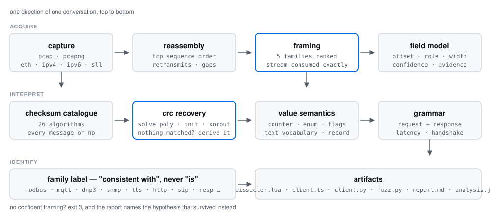
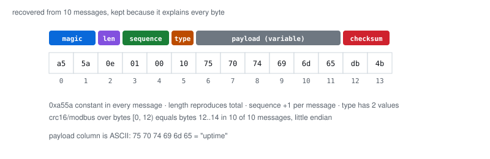

<p align="center">
  
</p>

<h1 align="center">protopath: Infer Any Wire Protocol</h1>

<h3 align="center">One MCP server that turns a packet capture into a protocol model, down to the checksum.</h3>

<p align="center"><b>See traffic you cannot read. Learn how it is framed, then build against it.</b></p>

<p align="center">
  <a href="https://github.com/fa33az/protopath/blob/main/LICENSE"></a>
  <a href="https://github.com/fa33az/protopath/actions/workflows/ci.yml"></a>
  
  
  
  
</p>

<p align="center">
  <b>pcap</b> · <b>pcapng</b> · <b>TCP reassembly</b> · <b>5 framing families</b> · <b>26 checksums</b> ·
  <b>CRC recovery</b> · <b>field semantics</b> · <b>Wireshark dissector</b>
</p>

---

See traffic from a device, a plugin, a game, an appliance you do not have the source for. Ask
protopath what the messages are. It reports how they are framed, where the fields start, which
one is a counter, what a check value actually computes, what the payload says, who answered whom,
and which published protocol the whole thing resembles — each answer attached to the bytes that
produced it.

```
PROTOPATH  1 proprietary protocol recovered, 0 bytes left unexplained

  framing      length-prefixed, 2-byte big-endian length at offset 0, bias 2      (0.91)
  fields       length · sequence(2 BE) · reserved · payload · checksum
  checksum     crc-16 poly 0x8f57 init 0x1234 refin/refout, covers [0, len-2) —— 10/10
  semantics    reserved: constant 0x21 · sequence: counter (+1) · payload: 10 printable runs
  grammar      10 exchanges, median round trip 1.4 ms, one request type → one reply type
  messages     10 outbound, 10 inbound, 2 retransmissions dropped
```

That checksum was in no catalogue. The polynomial was solved from the messages themselves.

<p align="center">
  
</p>

That layout was not entered anywhere. It is what remained after every other segmentation was
ruled out.

---

## Quick start

From source, which is how it runs today:

```console
$ git clone https://github.com/fa33az/protopath && cd protopath
$ npm install && npm run build && npm link
$ protopath analyze captures/binary-session.pcap
```

The package is publish-ready as `protopath-mcp`; once it is on the registry, `npx protopath-mcp`
replaces the three commands above.

No native dependency, no compiler, no capture library. Everything above the operating system is
in the repository.

### Set up your agent

```console
$ protopath setup --yes
```

Writes `.mcp.json` in the current directory with a `protopath` server entry and prints the
equivalent one-liner for Claude Code, Cursor and Codex. Without `--yes` it prints and writes
nothing.

### Ask your agent

> Read the capture at `captures/custom-crc.pcap`. What is the framing, which bytes are the
> sequence counter, what checksum is it using, what do the payloads say, and write me a client
> that encodes a valid request.

The agent calls `list_flows`, `analyze_capture`, `infer_fields`, `detect_checksums`,
`recover_checksum_parameters`, `explain_semantics`, `trace_conversation`, `emit_artifacts` and
`diff_captures`. The same analysis is available from the terminal, so the two never disagree.

### Use it as a library

```js
import { analyzeFile, recoverCrc, inferSemantics, emitClient } from 'protopath';

const analysis = analyzeFile('captures/custom-crc.pcap');
const flow = analysis.flows[0];

console.log(flow.forward.fields);        // offsets, roles, confidence, evidence
console.log(flow.forward.crcRecovery);   // poly, init, refin, refout, xorout — verified
console.log(flow.forward.semantics);     // value domains and payload vocabulary
console.log(flow.grammar);               // request/response pairing and latency
console.log(emitClient(flow, 'ts'));     // a compiling client, not a template
```

> **Analysis, not ground truth.** Every finding carries a score and the hypothesis it could not
> rule out. When nothing clears the threshold the tool says so and exits `3` instead of returning
> a confident-looking guess. Treat the field table as a map with a margin of error, not as a
> specification.

**[Design](docs/design.md)** · **[CRC recovery](docs/crc-recovery.md)** · **[Capture formats](docs/captures.md)** · **[CLI](#cli)** · **[MCP tools](#mcp-tools)**

---

## How it works

<p align="center">
  
</p>

**Framing comes first**, because a wrong frame length corrupts everything after it. Five families
are enumerated — length-prefixed, start-marker, terminator-delimited, fixed-size, unframed — and a
candidate only survives if it splits the stream into three or more messages and lands exactly on
the last byte. An incorrect frame length will fit the first message and then miss the end of the
buffer, which is why that single rule removes most wrong answers.

**Fields are grouped** from per-offset statistics: constant runs become `magic` or `reserved`,
two- and four-byte monotone runs become `sequence`, the field that reproduces message length
becomes `length`, a low-cardinality byte becomes `type`, and the rest is `payload`. Wide counters
are searched before byte-level grouping, because a two-byte little-endian counter otherwise looks
like a constant byte followed by a stepping one.

**Checksums are enumerated, not guessed.** Twenty-six algorithms across widths 1, 2 and 4, every
field position, every covered range, re-verified on every message.

**When nothing named matches, the parameters are solved.** CRC is affine in its input, so two
messages of equal covered length have identical init and xorout contributions; xoring their check
values cancels both and leaves one equation in the polynomial. Every polynomial that satisfies it
is verified against the whole capture, and the initial value then falls out of a small linear
system over GF(2) built from two messages of different length. Nothing is fitted: a parameter set
either reproduces every byte or it is discarded. When the capture cannot tell init from xorout —
every message the same length — the report says the split is a convention.

**Then the values are read.** A field that only ever holds 0 and 1 is a flag, not a number. A byte
that tracks message length minus a constant is a body-length field. A four-byte field whose bytes
are printable ASCII is a word, even when reading it as an integer lands in the unix-seconds
window. Text payloads become a vocabulary: leading token as verb, later positions typed as
integer, decimal, address or identifier.

**Then the conversation is paired.** Requests are matched to the responses that answer them, FIFO,
which surfaces round-trip latency, pipelining, reply shapes and any leading exchange that never
repeats — the place a replay should start.

**Last, and only when the structure is specific enough, a family is named.** Modbus/TCP needs the
MBAP length bias, the constant protocol identifier, the unit identifier and function codes in
range; a port number is one signal and never the reason. A wrong family label is worse than none,
so a custom protocol comes back unlabelled.

The generated TypeScript is compiled by the test suite and the generated Python is executed
against the real captures: decode, re-encode byte-for-byte, reject a corrupted message. If the
generator regresses, the tests fail before the README can lie.

Read the full method, including the scoring formulas and the symptom-to-cause table:
**[docs/design.md](docs/design.md)**.

---

## What it can read

| Capture side | Recovered | Notes |
|---|---|---|
| pcap, microsecond | frames, flows, bytes | classic format |
| pcap, nanosecond | frames, flows, bytes | `0xa1b23c4d` magic |
| pcapng | frames, flows, bytes | SHB/IDB/EPB/SPB, per-interface `if_tsresol` |
| Ethernet | MAC → IP → transport | VLAN and QinQ tags skipped correctly |
| Raw IP, Linux SLL, null/loopback | IP → transport | link types 101, 113, 0 |
| IPv4 | TCP, UDP payloads | non-first fragments skipped and counted |
| IPv6 | TCP, UDP payloads | hop-by-hop, routing, destination options skipped |
| TCP | reassembled stream | sequence-number based, retransmits dropped, gaps reported |
| UDP | concatenated datagrams | arrival order, no session |
| TLS, QUIC, fragmented IP | nothing | opaque; decrypt or record at the API boundary |

## What it infers

| Family | Enumerated over | Kept when |
|---|---|---|
| length-prefixed | offset 0–8 × width 1/2/4 × endian × bias −6..12 | stream consumed exactly, 3+ messages |
| start-marker | first 2, 3, 4 bytes | every message starts with it, density below 50% |
| delimiter | `0a`, `0d0a`, `0d`, `00`, `0000`, `ff`, `03` | exact coverage, no residue |
| fixed-size | every divisor 4–1024 | 3+ messages |
| unframed | always | floor of the ranking, never a claim |

| Field role | Evidence required |
|---|---|
| `magic` | identical bytes in every message, at offset 0 |
| `length` | decoding it reproduces every message length |
| `sequence` | value steps by exactly 1 per message, 1/2/4 bytes, either endianness |
| `type` | distinct count under `max(6, 75%)`, at most one per direction |
| `checksum` | matches every message for a named algorithm, or a recovered parameter set |
| `reserved` | constant, but not a framing marker |
| `payload` | the remainder, bounded by the framing |

| Checksum family | Names |
|---|---|
| 8-bit | `sum8`, `xor8`, `crc8`, `crc8/itu`, `crc8/rohc`, `crc8/maxim`, `crc8/darc`, `crc8/sae-j1850`, `crc8/autosar`, `crc8/cdma2000` |
| 16-bit | `sum16`, `inet16`, `fletcher16`, `crc16/ccitt-false`, `crc16/xmodem`, `crc16/aug-ccitt`, `crc16/genibus`, `crc16/t10-dif`, `crc16/profibus`, `crc16/kermit`, `crc16/x25`, `crc16/modbus`, `crc16/arc`, `crc16/dnp` |
| 32-bit | `fletcher32`, `adler32`, `crc32/ieee`, `crc32/c`, `crc32/mpeg2`, `crc32/bzip2` |
| arbitrary | recovered from the data: polynomial, init, refin, refout, xorout, covered range |

| Value domain | Meaning |
|---|---|
| `counter` | steps by one per message |
| `length` | equals message length minus a constant |
| `boolean` | only ever 0 and 1, both present |
| `enum` | small closed set of codes |
| `flags` | few bits ever set, values not consecutive |
| `timestamp` | lands in the unix seconds or milliseconds window |
| `text` | printable ASCII in every message |
| `opaque` | a check value, or nothing better than a range |

| Protocol family | Structural signals required |
|---|---|
| Modbus/TCP | MBAP length bias, constant protocol id, unit id, function codes in range |
| MQTT | control nibble plus a base-128 varint that accounts for the remainder |
| DNP3 | `0x0564` start bytes on 90% of messages |
| SNMP | BER `0x30` with a short-form length equal to the remainder |
| TLS | record type, version `0x03xx`, record length equal to the remainder |
| HTTP/1.x, SIP, FTP, SMTP, memcached | request and reply line grammars |
| RESP | single-byte type prefix on 95% of messages |

Every family needs at least two independent signals; four or more scores 0.95.

---

## Showcases

Seven captures ship with the repository. Six are synthetic with documented ground truth, so the
test suite checks each inference against a known answer instead of against another inference. The
seventh was recorded from a real protocol implementation.

### A checksum that exists in no catalogue

`captures/custom-crc.pcap` uses CRC-16 with polynomial `0x8f57` and initial value `0x1234`. Neither
appears in any published table, so the catalogue finds nothing:

```console
$ protopath analyze captures/custom-crc.pcap
```

```
**Recovered checksum parameters**

No catalogued algorithm matched, so the parameters were solved from the messages themselves.

- polynomial: `0x8f57` (normal form), `0xeaf1` reflected
- init: `0x1234`, xorout: `0x0000`, refin true, refout true
- covers bytes `[0, len-2)`, field read le at `len-2`
- verified against all 10 messages, no exceptions
```

The generated client embeds those exact constants, and the test suite compiles it, decodes a
captured message, re-encodes it byte-for-byte, and confirms a one-bit corruption is rejected.

```console
$ protopath emit captures/custom-crc.pcap --out out/custom
$ grep -n crcCompute out/custom/client.ts | head -2
```

The same fixture demonstrates the honest failure mode: every request in the capture carries the
same type byte, so that byte is reported as `reserved` rather than as a `type` the data does not
support. The report says so.

### Modbus/TCP, recorded from a real implementation

```console
$ python scripts/record-modbus.py captures/modbus-session.pcap
$ protopath analyze captures/modbus-session.pcap
```

```
| Field        | Role     | Offset | Width | Confidence | Why                                      |
|--------------|----------|--------|-------|------------|------------------------------------------|
| sequence     | counter  | 0      | 2     | 0.95       | +1 per message, 2-byte big endian        |
| reserved     | reserved | 2      | 2     | 0.90       | 0x0000 in all 15 messages                |
| length       | length   | 4      | 2     | 0.97       | reproduces message length when 6 is added|
| reserved_2   | reserved | 6      | 1     | 0.90       | 0x01 in all 15 messages                  |
| type         | opcode   | 7      | 1     | 0.80       | 8 distinct function codes                |
| payload      | payload  | 8      | var   | 0.60       | 12 to 19 bytes                           |
```

That is the Modbus/TCP application header, recovered from bytes a pymodbus client generated. Both
directions agreed independently, and no checksum was claimed because Modbus/TCP has none. The
family label is derived from structure, not from port 502:

```
### Consistent with Modbus/TCP — confidence 0.95
- a 16-bit big-endian length at offset 4 with bias +6 is the MBAP length field
- bytes 2..4 are 0x0000 in every message: the MBAP protocol identifier
- byte 6 is constant across messages: the MBAP unit identifier
- byte 7 holds 8 distinct function codes in the Modbus range
```

And the trace shows the one operation the PLC rejected:

```console
$ protopath trace captures/modbus-session.pcap
```

```
10.1.0.10:15021 <> 10.1.0.20:15020 tcp — 15 exchange(s)
latency  min 0.00 ms   median 1.18 ms   max 2.03 ms   over 15 round trip(s)

#   request    response   latency
--  ---------  ---------  -------
0   type=0x03  type=0x03  0.00 ms
...
10  type=0x04  type=0x84  1.18 ms
```

`0x84` is the Modbus exception response — function code `0x04` with the error bit set. The tool
paired it because it paired the exchange, not because it knows what an exception is.

This capture is the reason three framing rules exist — over-segmentation on zero-heavy streams,
ambiguous length width, and an opcode threshold too strict for an eight-code alphabet. Every one
of them is documented with the failure that produced it:
**[docs/showcase-modbus.md](docs/showcase-modbus.md)**.

### Binary session: framing, counter and checksum at once

```console
$ protopath analyze captures/binary-session.pcap
```

```
| Field                   | Role     | Offset | Width | Confidence | Why                                              |
|-------------------------|----------|--------|-------|------------|--------------------------------------------------|
| magic                   | magic    | 0      | 2     | 0.95       | 0xa55a in all 10 messages                        |
| length                  | length   | 2      | 1     | 0.97       | reproduces every message length                  |
| sequence                | counter  | 3      | 2     | 0.95       | +1 per message, 2-byte little endian             |
| type                    | opcode   | 5      | 1     | 0.80       | 2 distinct values across 10 messages             |
| payload                 | payload  | 6      | var   | 0.60       | lengths range 8..19                              |
| checksum_crc16_modbus   | checksum | end-2  | 2     | 1.00       | crc16/modbus over [0, len-2), 10/10              |
```

The capture deliberately contains out-of-order segments and retransmissions. Reassembly keeps the
stream intact and reports the retransmissions rather than hiding them.

### Text protocol: knowing when to stop

```console
$ protopath analyze captures/text-session.pcap
```

Resolution is a single `text` field. The correct answer for a line protocol is that the structure
lives in the words, not in byte offsets, and the tool says that instead of inventing fields — then
reads the words anyway:

```
**Payload — text, 3 leading token(s)**

| Kind       | Position | Values                    |
|------------|----------|---------------------------|
| verb       | 0        | `GET` ×4                  |
| verb       | 0        | `PING` ×2                 |
| verb       | 0        | `SET` ×2                  |
| identifier | 1        | `temp`, `led`, `uptime`    |
```

### Datagrams with no session

```console
$ protopath analyze captures/sensor-udp.pcap
```

24 datagrams, start-marker `0xaa55`, `sequence` detected at byte 3, `type` read as a two-value
enum. This is why the counter detector exists: on UDP there is no transport-level ordering to lean
on.

### A protocol revision, caught

```console
$ protopath diff captures/binary-session.pcap captures/binary-session-v2.pcap
```

```
flow 10.0.0.10:41000 <> 10.0.0.20:7401 tcp -> 10.0.0.10:42000 <> 10.0.0.20:7401 tcp
  framing: length-prefix 1B be @2 bias 0 -> length-prefix 1B be @2 bias 0
  verdict: fields moved; a client built for the first capture will misparse the second
  changed  payload — moved from head offset 6 to 5
  added    payload — new field at head offset 5
```

The honest answer is that a field disappeared and the bytes shifted. The tool does not claim to
know a type byte was removed; it shows where the layout moved and lets you decide.

---

## Generated artifacts

| File | Contents |
|---|---|
| `dissector.lua` | Wireshark dissector, consumes every message in a segment, renders text payloads as text |
| `client.ts` | decoder, encoder, checksum inverse, verifier — compiled in CI |
| `client.py` | same, executed against the capture in CI |
| `fuzz.py` | mutation harness reusing `client.py` for encoding |
| `report.md` | the full report: semantics, pairing, recovered parameters, rejected hypotheses |
| `analysis.json` | everything structured, buffers as hex |
| `messages.jsonl` | every message with offset, timestamp, label, hex, and decoded text |

---

## CLI

```
protopath flows   <capture>                 list conversations in a capture
protopath analyze <capture>                 framing, fields, checksums, semantics, families
protopath trace   <capture>                 pair requests with responses, show latency
protopath emit    <capture> [--out <dir>]   write dissector, clients, harness, report
protopath diff    <captureA> <captureB>     compare two inferred layouts
protopath setup   [--yes]                   register the MCP server with an agent
```

`--flow <key>` · `--max-flows <n>` · `--out <dir>` · `--port <n>` · `--json` ·
`--targets lua,ts,python,fuzz,report`

Exit codes: `0` confident analysis · `1` error · `3` no hypothesis cleared the threshold.

## MCP tools

| Tool | Purpose |
|---|---|
| `list_flows` | conversations with byte counts, gaps and retransmissions |
| `analyze_capture` | the full report, markdown or JSON |
| `infer_fields` | field table for one direction, with the reason for each boundary |
| `detect_checksums` | catalogued algorithms and the range each covers |
| `recover_checksum_parameters` | solve polynomial, init, reflection and xorout from the bytes |
| `explain_semantics` | value domains, text vocabulary, printable runs, record layout |
| `trace_conversation` | request/response pairing, latency, handshake |
| `emit_artifacts` | write dissector, clients, harness and report to a directory |
| `diff_captures` | framing changes, moved fields, fields that stopped varying |

---

## Limits

| Symptom | Cause | Workaround |
|---|---|---|
| Chatty protocol looks unframed | framing fits none of the five families | capture a longer session; check the runner-up hypotheses |
| `reserved` where a type belongs | the field never varied in this capture | capture both sides, or a session with more message types |
| Two hypotheses within 0.05 | the protocol genuinely fits both | compare the two field tables; the wrong one produces junk names |
| Catalogued checksum finds nothing | private polynomial or seed | the recovery pass runs automatically on the strongest flow |
| Recovery finds nothing | fewer than five messages, constant check field, or no two messages of equal covered length | capture more traffic; a named algorithm still runs first |
| `init` marked ambiguous | every message has the same length, so init and xorout are interchangeable | capture a message with a different body length |
| 32-bit CRC with a private polynomial | recovery enumerates 2^15 polynomials for width 16, 2^31 for width 32 | try the catalogue first; it carries four 32-bit algorithms |
| A field boundary off by one | a header byte varies too much to classify | inspect the four hex messages the report prints |

Also: a single-byte start marker is never accepted as a boundary, a capture that reuses a 4-tuple
across connections merges them, and the deep recovery pass runs on one flow per capture so a
many-conversation file stays fast.

## FAQ

**Which agents can use it?** Any MCP client. `protopath setup --yes` writes `.mcp.json`; Claude
Code, Cursor and Codex all read that shape or the printed equivalent.

**Do I need Wireshark?** No. The dissector is an output, not a dependency. It exists so the model
can be checked by a human against live traffic afterwards.

**Does it upload my capture?** No. There is no network call anywhere in the codebase.

**Is the field table a specification?** No. It is a ranked hypothesis with per-field confidence.
The report prints the runner-up framing and the reassembly damage for exactly this reason.

**Is the recovered checksum a guess?** No. It is a parameter set that reproduces every captured
message exactly, and the report names what the capture could not settle. A CRC that is right for
these messages says nothing about messages the capture never contained.

**Why exit code 3?** So a pipeline can tell "no structure found" apart from "the file would not
parse". A report that only half-holds should not look like success.

**Does it work on TLS or QUIC?** Not on ciphertext. Decrypt first, or record at the point where
plaintext exists. A TLS record layer is still identified when the handshake is visible.

**What is the answer to the benchmark?** There is no benchmark. The fixtures are the honest
substitute: seven protocols with documented layouts — six synthetic, one recorded from pymodbus —
and 62 tests that fail when the inference changes.

## Documentation

- [Design](docs/design.md) — the method, the scoring formulas, the failure modes
- [CRC recovery](docs/crc-recovery.md) — the algebra, the ambiguity, and a fixture that proves it
- [Modbus showcase](docs/showcase-modbus.md) — a real capture, and the three defects it exposed
- [Capture formats](docs/captures.md) — the seven fixture protocols and their ground truth
- [CLI](#cli) and [MCP tools](#mcp-tools) — the two interfaces to the same analysis

## Development

```console
$ npm install
$ npm run captures   # regenerate captures/ deterministically
$ npm test           # build and run 62 tests
```

```
src/core/pcap/       pcap and pcapng readers
src/core/net/        link/IP/transport decoding, TCP reassembly
src/core/infer/      framing, fields, checksums, CRC recovery, semantics, grammar, families
src/core/emit/       Lua dissector, TypeScript and Python clients, mutation harness
src/core/            pipeline, report, diff
src/cli/             command line
src/mcp/             MCP server over stdio
tests/               unit and end-to-end tests against the fixtures
scripts/             fixture capture generator, real Modbus recorder
```

## License

MIT. Use it on traffic you are authorised to inspect.
